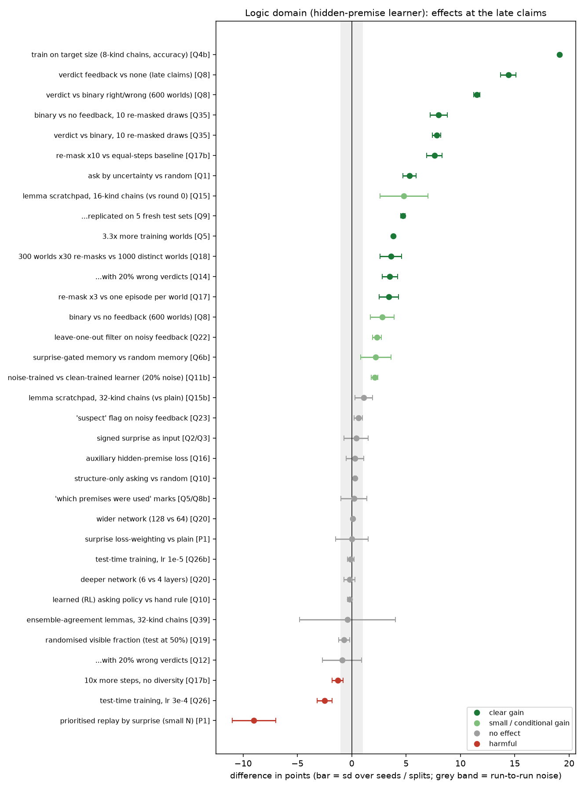
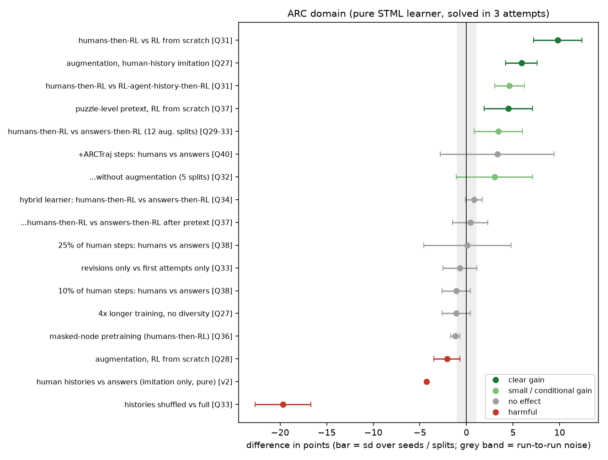

# Meta-analysis of the experiment programme

49 experiments with written predictions; 51 headline comparisons transcribed from CLAUDE.md section 7 (see the script for the source of each row).

## 1. How good were the predictions?

Across 49 experiments, 116 predictions were written before running; 69.5 held ('mostly' and 'half' counted 0.5): **60%**.
By half: first 25 experiments: 68%, last 25: 51%.
Interpretation: the programme was mostly exploratory, so predicted effects often failed (a failed prediction is information, not a failed experiment). The hit rate is far from perfect, which is also a calibration warning: the analyst's intuition about which tricks help was wrong about half of the time.

## 2. What kind of effects did we find?

Of 51 headline comparisons: 15 clear gains, 8 small or conditional gains, 22 no effect (inside noise), 6 harmful.
Median sd of a paired difference over seeds / splits: 0.9 points (iqr 0.5-1.8); single runs of the same condition differ by about 1 point in logic and about 3 points on ARC.
Median size of a clear gain: 5.9 points; largest: train on target size (8-kind chains, accuracy) (+19.1), verdict feedback vs none (late claims) (+14.4), verdict vs binary right/wrong (600 worlds) (+11.5).

## 3. Figures

